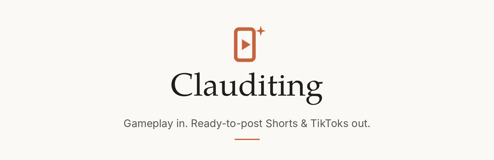
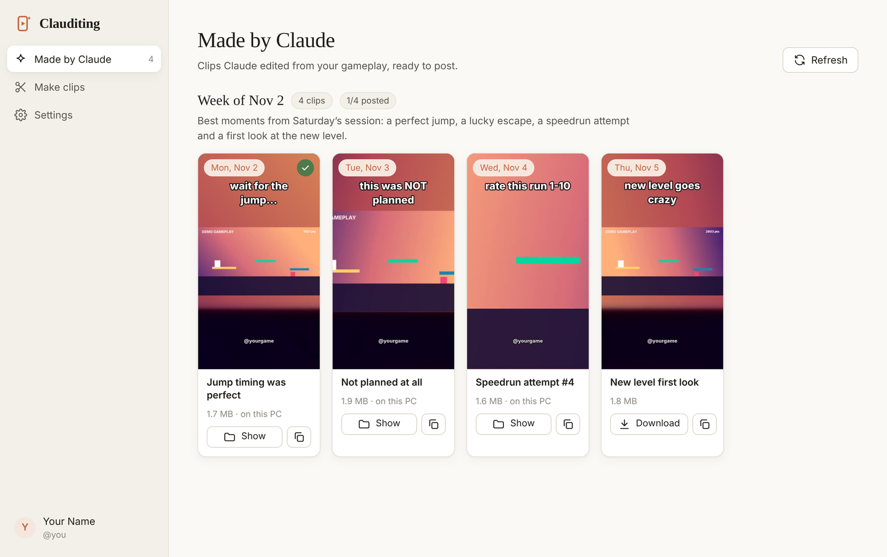
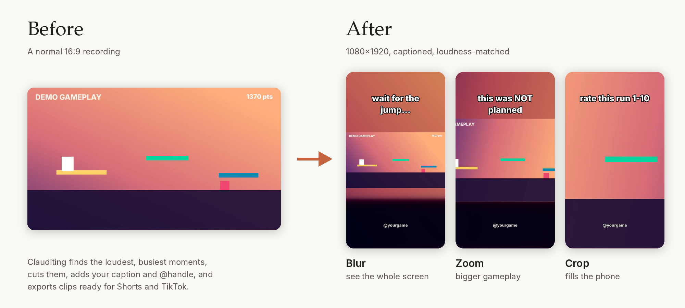
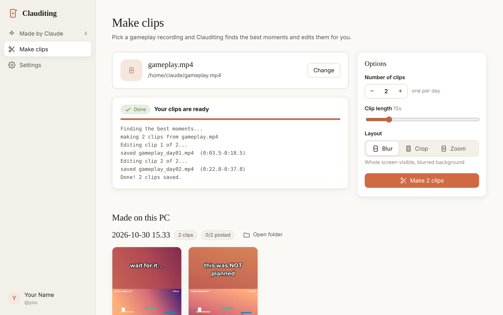
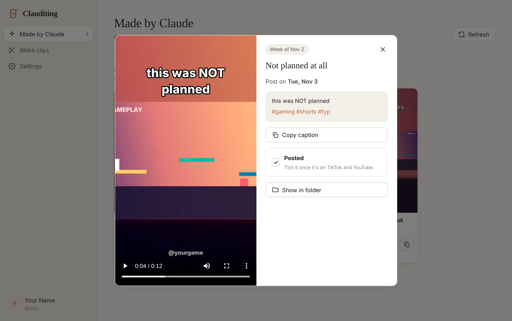
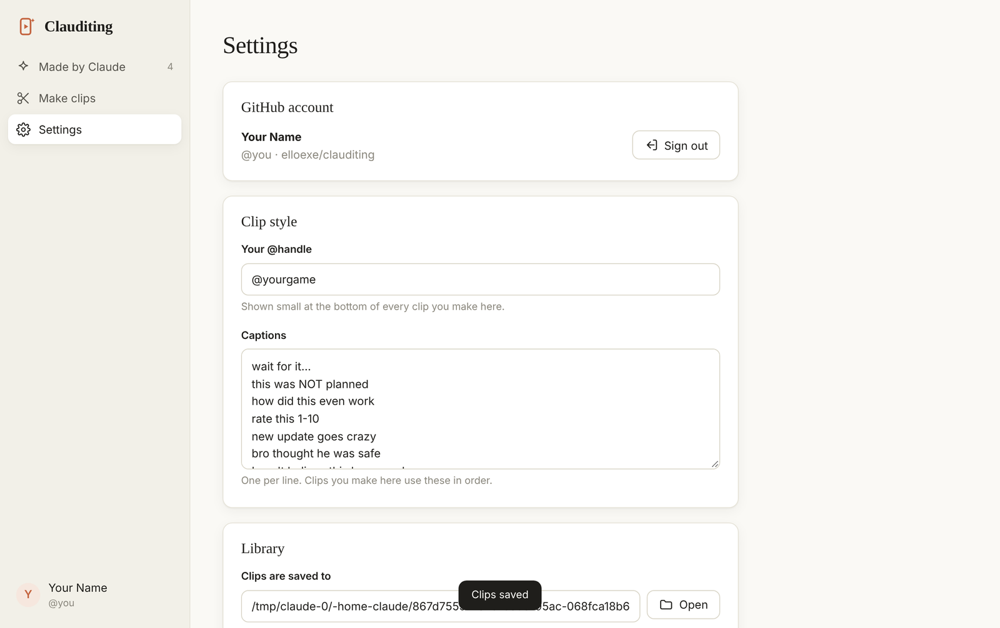
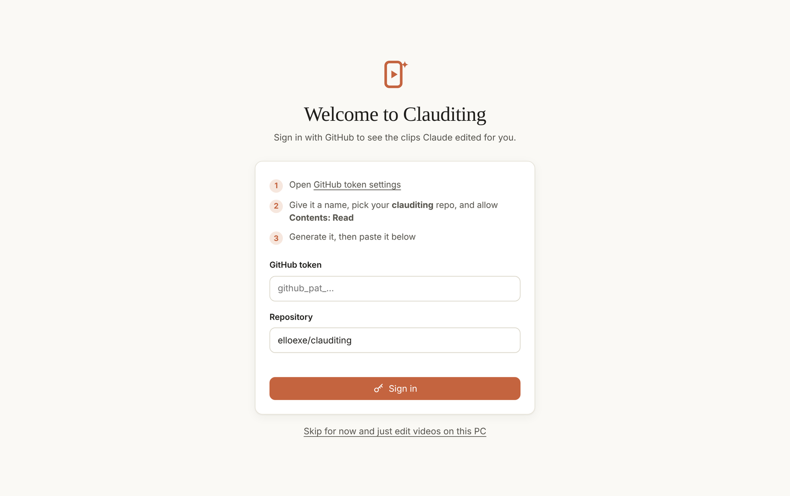
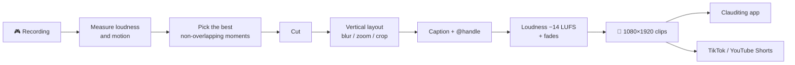

<p align="center">
  
</p>

<p align="center">
  <a href="https://github.com/elloexe/clauditing/actions/workflows/ci.yml"></a>
  <a href="https://github.com/elloexe/clauditing/actions/workflows/build-exe.yml"></a>
  <a href="https://github.com/elloexe/clauditing/releases/tag/app"></a>
  
  <a href="LICENSE"></a>
</p>

<p align="center">
  <a href="#-download">Download</a> ·
  <a href="#-features">Features</a> ·
  <a href="#-command-line">Command line</a> ·
  <a href="#-how-it-works">How it works</a> ·
  <a href="#-development">Development</a> ·
  <a href="CHANGELOG.md">Changelog</a>
</p>

---

**Clauditing** turns long gameplay recordings into short, vertical, captioned clips for **YouTube Shorts** and **TikTok**. It finds the best moments on its own, edits them to 1080×1920, adds your caption and @handle, evens out the volume and hands you a week of posts.

It comes as a **Windows app** with a clip library, and as a **command-line tool** for scripting and batch jobs.

<p align="center">
  
</p>

## ⬇ Download

| Platform | Get it |
|---|---|
| **Windows 10 / 11** | [**Clauditing.exe**](https://github.com/elloexe/clauditing/releases/tag/app). One file, ffmpeg built in, nothing else to install. |
| macOS / Linux | Run from source: see [Command line](#-command-line) and `python -m app.main` |

> [!NOTE]
> The .exe isn't code-signed yet, so Windows SmartScreen may warn you the first time. Click **More info → Run anyway**.

## ✨ Features

<table>
<tr>
<td width="50%" valign="top">

### 🎯 Finds the highlights for you
Scores every moment of your recording by **loudness** and **on-screen action**, then picks the best non-overlapping moments. No scrubbing through hours of footage.

### 📱 Vertical, in three styles
**Blur** keeps the whole screen on a blurred background, **Zoom** makes the gameplay bigger, **Crop** fills the phone. Already-vertical clips just get cleaned up.

### 💬 Captions & @handle
Big, outlined captions that wrap to fit, placed where they won't cover stream overlays or watermarks. Your @handle goes on every clip.

</td>
<td width="50%" valign="top">

### 🔊 Ready to post
Loudness normalised to −14 LUFS (what TikTok and YouTube expect), quick fades in and out, H.264 + AAC, `faststart`.

### 🗓 A week at a time
One recording in, seven clips out, numbered by day. Every batch shows its post dates, ready-to-copy captions with hashtags, and a **Posted** tick box.

### ✨ Made by Claude
Clips edited for you by Claude land in the app automatically (from this repo's releases), so you can watch, download and post them.

</td>
</tr>
</table>

<p align="center">
  
</p>

<details>
<summary><b>More screenshots</b></summary>
<br>

| Make clips on your PC | Watch, copy caption, mark posted |
|---|---|
|  |  |
| **Settings** | **Sign in** |
|  |  |

</details>

## ⌨ Command line

Needs **Python 3.9+** and **ffmpeg** (`winget install ffmpeg` · `brew install ffmpeg` · `sudo apt install ffmpeg`).

```bash
git clone https://github.com/elloexe/clauditing && cd clauditing
pip install -e .
```

**Make a week of clips from one recording:**

```bash
clauditing auto session.mp4 --count 7
# → out/session_day01.mp4 … out/session_day07.mp4
```

| Command | What it does |
|---|---|
| `clauditing scan VIDEO` | Lists the best moments and saves a preview sheet (`out/VIDEO_sheet.jpg`) |
| `clauditing auto VIDEO --count 7` | Scan + edit the top N moments, in time order |
| `clauditing cut VIDEO --start 72 --end 88 --caption "no way"` | Edit one exact clip |
| `clauditing batch plan.json` | Edit a list of clips with their own captions and layouts ([example](plan.example.json)) |

<details>
<summary><b>All options</b></summary>

| Option | Commands | Meaning |
|---|---|---|
| `--out DIR` | all | Output folder (default `out`) |
| `--config FILE` | all | Settings file (default `config.json` next to the script) |
| `--layout blur\|zoom\|crop` | cut, auto | Vertical layout |
| `--length SECONDS` | scan, auto | Clip length (default 15) |
| `--speed 1.25` | cut | Speed up or slow down (audio pitch is kept) |
| `--caption-y 0.25` | cut | Caption height: `0` = top, `1` = bottom (default `0.13`) |
| `--top N` / `--count N` | scan / auto | How many moments |

In `plan.json` each clip can set `video`, `start`, `end`, `caption`, `layout`, `speed`, `caption_y` and `name`.

</details>

### Settings

Copy [`config.example.json`](config.example.json) to `config.json`:

| Key | Default | |
|---|---|---|
| `handle` | `""` | Shown at the bottom of every clip, e.g. `@yourgame` |
| `layout` | `"blur"` | Default layout |
| `clip_length` | `15` | Seconds per clip |
| `caption_size` / `caption_color` / `caption_outline` | `92` / `white` / `black` | Caption style |
| `caption_y` | `0.13` | Caption height on screen |
| `font` | auto | A `.ttf`/`.otf`, or drop one into `fonts/` |
| `default_captions` | 7 starters | Captions `auto` rotates through |

## ⚙ How it works



1. **Scoring.** Audio is decoded at 8 kHz and measured in 0.25 s windows; video is decoded as tiny greyscale frames to measure frame-to-frame change. Both are turned into robust z-scores (median / MAD) and combined, 60% audio and 40% motion.
2. **Picking.** The highest-scoring moments are taken greedily, skipping anything that would overlap a moment already picked. Each clip starts a little before its peak, so the build-up is in.
3. **Editing.** One ffmpeg filter graph per clip does the layout, caption, handle, speed change, fades and loudness normalisation in a single pass.

### The "Made by Claude" library

The app signs in with a **GitHub token** (read-only, this repo only) and lists every release whose tag starts with `clips-`. Each one holds the clips, thumbnails and a `manifest.json` with titles, captions, hashtags and post dates. [`tools/publish_batch.py`](tools/publish_batch.py) creates them.

## 🗂 Project layout

```
clauditing.py            the editor: scoring, cutting, layouts, captions (CLI entry point)
app/
  server.py              local API for the app: GitHub library, downloads, editing jobs
  main.py                desktop window (pywebview)
  ui/                    the interface (one HTML file + logo)
tools/publish_batch.py   publishes a batch of clips as a GitHub release
tests/                   pytest suite: editor + app server
.github/workflows/       CI (lint + tests) and the Windows .exe build
docs/                    images used in this README
```

## 🛠 Development

```bash
pip install -e ".[dev,app]"
pytest            # 27 tests, about a minute (needs ffmpeg)
ruff check . && ruff format --check .
python -m app.server   # run the app's backend and open the printed URL in a browser
python -m app.main     # or run the real desktop window
```

Every push runs [CI](.github/workflows/ci.yml) on Python 3.9, 3.12 and 3.13. Changes to the app also run the test suite **on Windows** with the bundled ffmpeg and publish a fresh `Clauditing.exe` ([workflow](.github/workflows/build-exe.yml)).

See [CONTRIBUTING.md](CONTRIBUTING.md) for how to propose changes.

## 🧭 Roadmap

- [x] Highlight detection (audio + motion)
- [x] Blur / zoom / crop vertical layouts
- [x] Windows app with clip library
- [x] Caption positioning for overlays
- [ ] Auto-generated subtitles from speech
- [ ] Kill-feed detection for shooters
- [ ] Direct upload to YouTube Shorts
- [ ] macOS app build
- [ ] Code-signed Windows build

## ❓ FAQ

<details>
<summary><b>Why sign in with GitHub and not a Claude account?</b></summary>

Anthropic doesn't allow third-party apps to sign in with Claude accounts. The clips Claude makes are published to this GitHub repo, so a GitHub token is all the app needs.
</details>

<details>
<summary><b>Can it post to TikTok by itself?</b></summary>

TikTok only lets audited apps post publicly through its API; unaudited apps can post private videos only. Until Clauditing goes through that audit, upload the clips yourself or with an approved scheduler (Buffer, Later, Metricool, Blotato).
</details>

<details>
<summary><b>Which games does it work with?</b></summary>

Any game. Scoring only looks at sound and movement, so it works for Roblox, Call of Duty, Fortnite, Minecraft and anything else you record.
</details>

<details>
<summary><b>Where are my clips saved?</b></summary>

In `Videos\Clauditing` by default. You can change this in **Settings**. Settings and your token are stored in `%APPDATA%\Clauditing`.
</details>

## 📄 License

[MIT](LICENSE) © elloexe

<sub>Clauditing is an independent project and is not affiliated with or endorsed by Anthropic.</sub>
